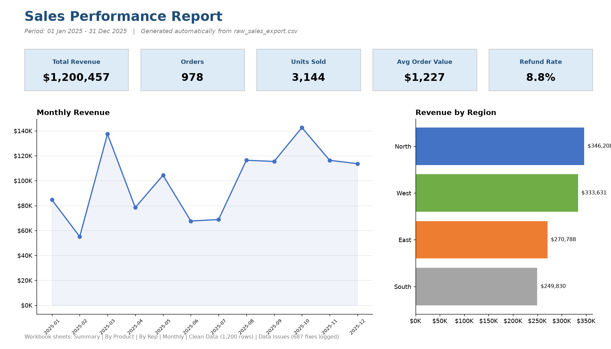

# Excel Report Automation – Sales Data

Takes a messy sales export and produces a polished, formatted Excel report in one command.

## The input problem (realistic mess)
`raw_sales_export.csv` (1,225 rows) contains the issues real client files have:
- 5 different date formats mixed together
- Prices as `$1,299.00`, `USD 1299`, `1299.00 `
- Inconsistent capitalisation and stray spaces in Region / Sales Rep / Product
- Missing quantities
- 25 duplicate orders

## The output
`output/Sales_Report_2025.xlsx` with 6 sheets:

| Sheet | Contents |
|-------|----------|
| Summary | Title block, 5 KPI cards, native Excel line chart (monthly revenue) and bar chart (revenue by region) |
| By Product | Revenue, units, orders, avg price per product, ranked |
| By Rep | Leaderboard with share % and a red→green colour scale |
| Monthly | Month × Region pivot with totals |
| Clean Data | Full cleaned dataset as a filterable Excel Table, frozen header |
| Data Issues | Every fix applied, by Order ID, with the reason (687 entries) |

Also writes `Sales_Report_2025.clean.csv` for downstream use.



## Run
```bash
python generate_sample_data.py                     # creates the messy demo file
python sales_report.py raw_sales_export.csv --out output/Sales_Report_2025.xlsx
python render_preview.py                           # optional PNG preview
```

Works with `.csv` or `.xlsx` input. Column names are mapped at the top of `sales_report.py` so it's quick to adapt to a client's export.
