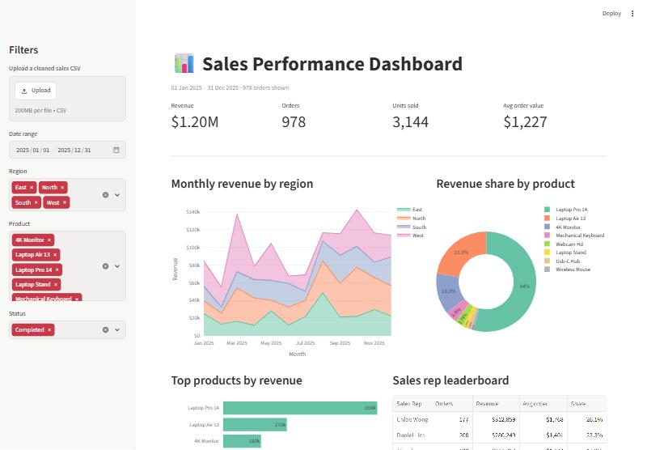

# Interactive Sales Dashboard (Streamlit + Plotly)



## Features
- Sidebar filters: date range, region, product, order status
- Upload your own CSV and the whole dashboard re-renders
- KPI cards with % change versus the previous period of equal length
- Stacked area chart (monthly revenue by region), donut (product share), ranked bar (top products)
- Sales rep leaderboard with in-cell bars
- Order-level table + "Download filtered CSV"

## Run
```bash
pip install streamlit plotly pandas
streamlit run app.py
```
Opens at http://localhost:8501

## Deploying for a client
- Free: Streamlit Community Cloud (connect a GitHub repo, one click)
- Private: Docker container on any VPS, or behind the client's login
- Data sources I've wired up: CSV/Excel, Google Sheets, PostgreSQL/MySQL, REST APIs
