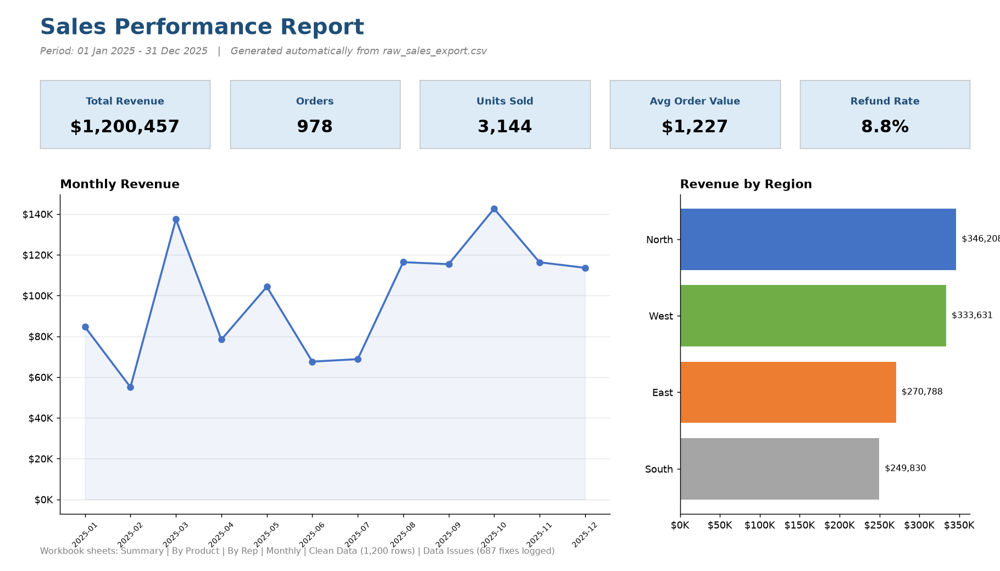
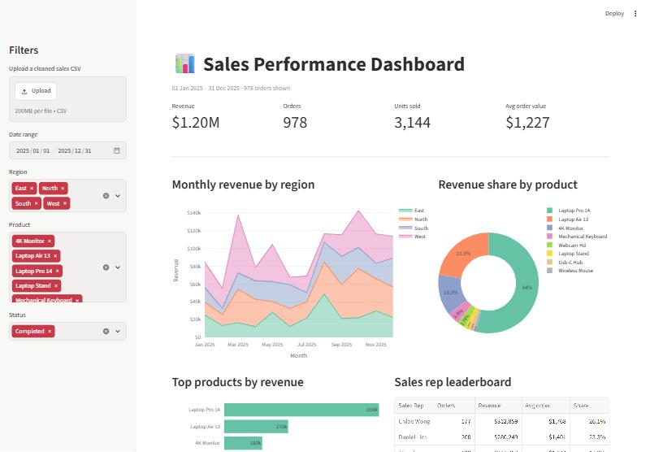

# Data Automation Portfolio

Three small, production-style Python projects that show the kind of work I deliver to clients:
web data extraction, Excel report automation, and interactive dashboards.

| # | Project | What it does | Tech |
|---|---------|--------------|------|
| 1 | [Web Scraper](01-web-scraper/) | Crawls a 50-page book catalogue (1,000 items) with pagination, retries and polite delays; exports clean CSV + Excel | requests, BeautifulSoup, pandas |
| 2 | [Excel Report Automation](02-excel-automation/) | Turns a messy 1,225-row sales export into a 6-sheet formatted workbook with KPIs, native Excel charts, pivots and a data-issues log | pandas, openpyxl |
| 3 | [Sales Dashboard](03-dashboard/) | Interactive dashboard with date/region/product filters, KPIs with period-over-period deltas, Plotly charts and CSV export | Streamlit, Plotly |

## Quick start

```bash
pip install -r requirements.txt

# 1. scrape
cd 01-web-scraper && python scraper.py --max-pages 5

# 2. excel report
cd ../02-excel-automation && python generate_sample_data.py && python sales_report.py raw_sales_export.csv --out output/Sales_Report_2025.xlsx

# 3. dashboard
cd ../03-dashboard && streamlit run app.py
```

## Previews

**Excel report (Summary sheet)**



**Interactive dashboard**



## What clients get

- Clean, commented code with a `--help` CLI
- Output in the format you actually use (CSV, Excel, Google Sheets, database)
- A short README explaining how to re-run it yourself
- Fast turnaround: most jobs like these are delivered in 1–3 days
